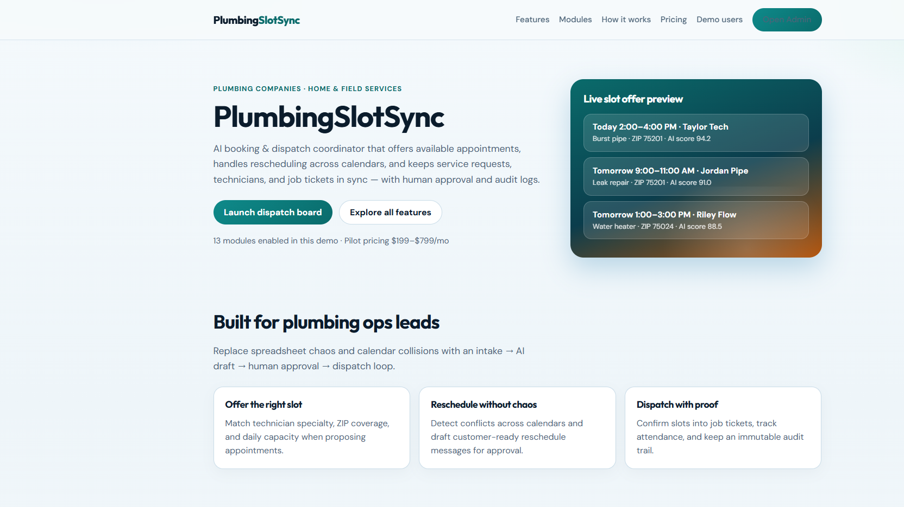
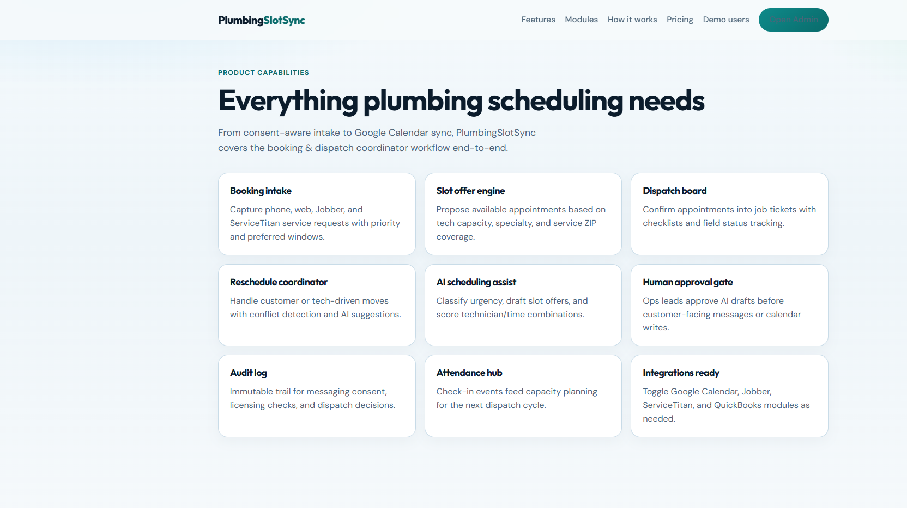
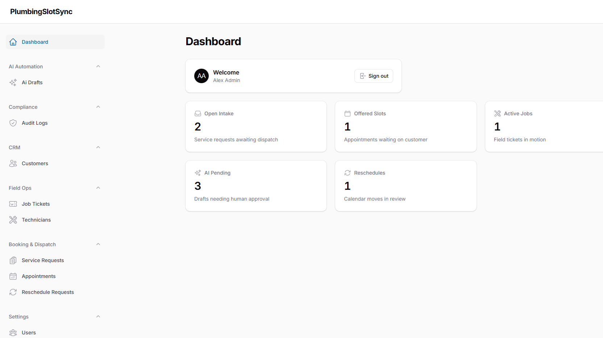
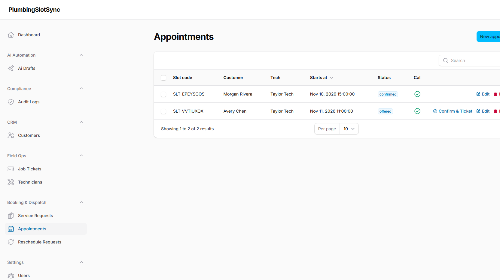

# PlumbingSlotSync — AI Booking & Dispatch Coordinator for Plumbing Companies

**PlumbingSlotSync** is a world-class Laravel + Filament SaaS for plumbing companies who need to **offer available appointments**, **reschedule across calendars**, and **dispatch field technicians** against service requests and job tickets — with AI drafts, human approval, and compliance audit logs.

> SEO H1: PlumbingSlotSync AI Plumbing Scheduling Software | Booking Dispatch Coordinator | ServiceTitan Jobber Calendar Automation

## Why plumbing owners buy PlumbingSlotSync

- Stop double-booking techs across Google Calendar, Jobber, and paper schedules
- Offer the next best slot by specialty, ZIP coverage, and daily capacity
- Let AI draft offers/reschedules while ops leads keep final approval
- Keep messaging consent, licensing checks, and dispatch decisions auditable

## Local demo (Docker)

```bash
docker compose up -d --build
```

- **App URL:** http://localhost:8114
- **Admin panel:** http://localhost:8114/admin
- MySQL host port: `33074` · Redis host port: `63804`

### Demo users (password for all: `password`)

| Role | Email | Access |
|------|-------|--------|
| Admin | admin@plumbingslotsync.test | Full panel + modules |
| Owner | owner@plumbingslotsync.test | Approvals & ops |
| Staff / Dispatcher | staff@plumbingslotsync.test | Intake, slots, dispatch |
| Technician | tech@plumbingslotsync.test | Field / tickets |
| Customer | customer@plumbingslotsync.test | Demo portal identity |

## Core workflow (MVP)

1. **Intake trigger** — service request from phone / web / Jobber / ServiceTitan
2. **AI draft/action** — classify urgency, score techs, draft slot offer or reschedule
3. **Human approval** — owner/dispatcher approves before customer-facing action
4. **Audit log** — immutable trail for compliance (messaging consent, licensing & safety)

## Feature modules (toggle ON/OFF)

| Module | Default | Purpose |
|--------|---------|---------|
| Booking Intake | ON | Capture plumbing service requests |
| Slot Offer Engine | ON | Propose available appointment windows |
| Dispatch Board | ON | Confirm slots → job tickets |
| Reschedule Coordinator | ON | Conflict-aware calendar moves |
| AI Scheduling Assist | ON | Draft/score/classify |
| Human Approval Gate | ON | Ops approval before send |
| Audit Log | ON | Compliance trail |
| Google Calendar Sync | ON | Two-way slot sync |
| Jobber Integration | OFF | Jobs mirror |
| ServiceTitan Integration | OFF | Availability mirror |
| QuickBooks Sync | OFF | Job → finance link |
| Technician Attendance Hub | ON | Check-in capacity |
| SMS Consent Messaging | ON | Consent-aware notices |
| Unicode PDF Job Tickets | ON | Multi-language PDFs |
| Universal Slug Pages | OFF | Multi-language SEO pages |
| AI Catalog Scrape | OFF | Fixture catalog ingest |
| Customer Booking Portal | ON | Homeowner slot requests |
| Licensing & Safety Checks | ON | License verification before dispatch |

Toggle modules in **Admin → Feature Modules**.

## Public marketing pages

- `/` — Home / product story
- `/features` — Full feature list
- `/modules` — Module matrix ON/OFF
- `/how-it-works` — Intake → audit loop
- `/pricing` — Pilot $199–$799/mo
- `/demo` — Demo credentials
- `/admin` — Filament operations console

## Screenshots






## Tech stack

- PHP 8.3 · Laravel 13 · Filament 4 · Livewire
- MySQL 8.4 · Redis 7
- Docker Compose (app + mysql + redis)
- Modular feature flags (`feature_modules` + `config/modules.php`)
- Multi-role users: admin, owner, staff, technician, customer

### Packagist acceleration packages

Preferred `imrandevbd/*` packages were unavailable as stable installs at build time; equivalent local modules ship instead (AI scheduling service, Filament admin, attendance logs, PDF/slug/catalog module flags). Swap packages in when published.

## Integrations roadmap

Jobber · ServiceTitan · QuickBooks · Google Calendar — exposed as toggleable modules with calendar integration records seeded for demo.

## Risk / compliance

MED — messaging consent, licensing and safety checks are first-class modules with audit logging.

## Related SEO keywords

plumbing scheduling software, plumbing dispatch software, plumbing appointment booking, field service scheduling, plumbing contractor CRM, ServiceTitan alternative, Jobber scheduling automation, Google Calendar plumbing sync, AI dispatch coordinator, plumbing reschedule automation, technician capacity planning, drain cleaning appointment booking, leak repair dispatch, water heater service scheduling, burst pipe emergency booking, sewer main line dispatch, home services SaaS, Laravel Filament admin, modular feature flags, multi-tenant plumbing ops, consent-aware SMS reminders, plumbing job tickets, field technician attendance, QuickBooks plumbing jobs, AI business automation 2026, USA plumbing companies software, booking and dispatch coordinator, service request intake, human-in-the-loop AI approval, audit log compliance plumbing, Home & Field Services automation, plumbing operations lead software, pilot SaaS $199-$799, PlumbingSlotSync

## Repository

- Repo: `plumbing-slot-sync-ai-booking-dispatch-coordinator-plumbing-companies-laravel-filament`
- Category: Plumbing Companies · Sector: Home & Field Services · Function: Scheduling

## Contact / Hire

- Developer: Imran Ahmed (IMRAN Dev BD)
- Website: https://imrandev.bd/contact
- Email: me@imrandev.bd
- GitHub: https://github.com/imranbru99
